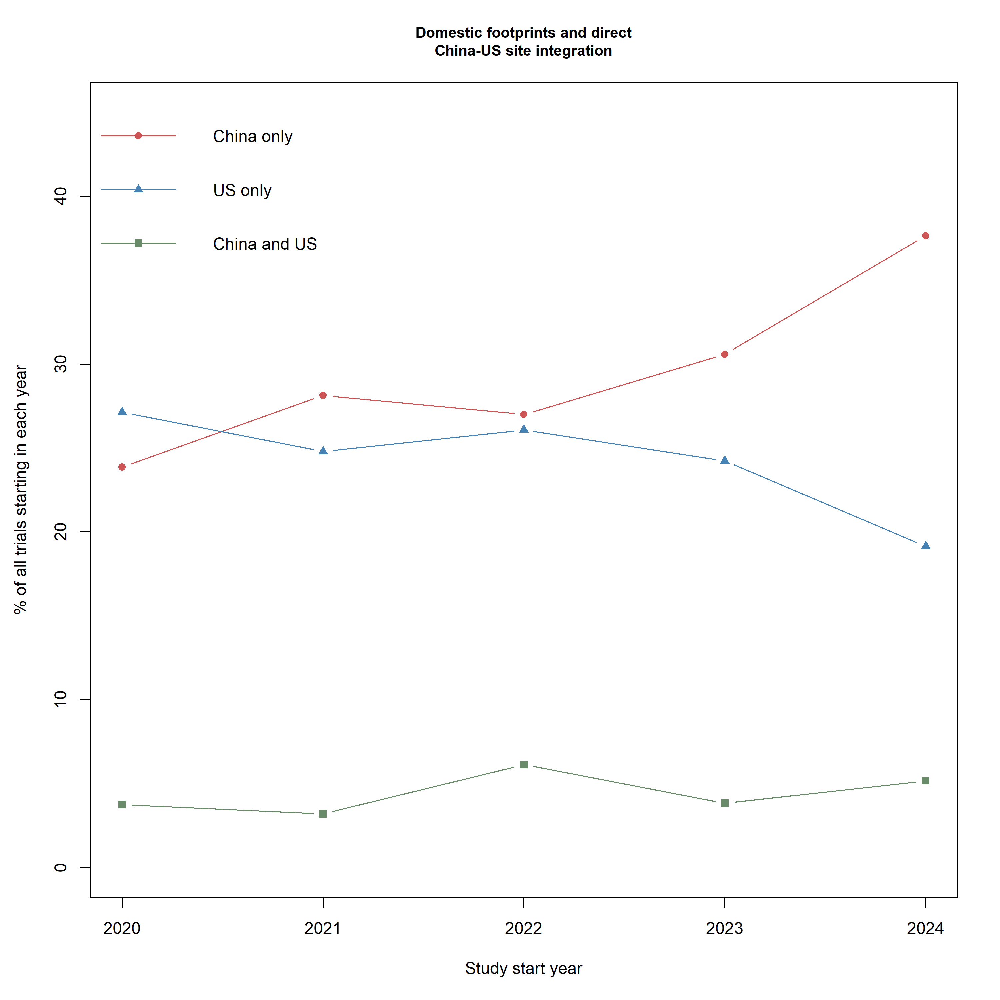
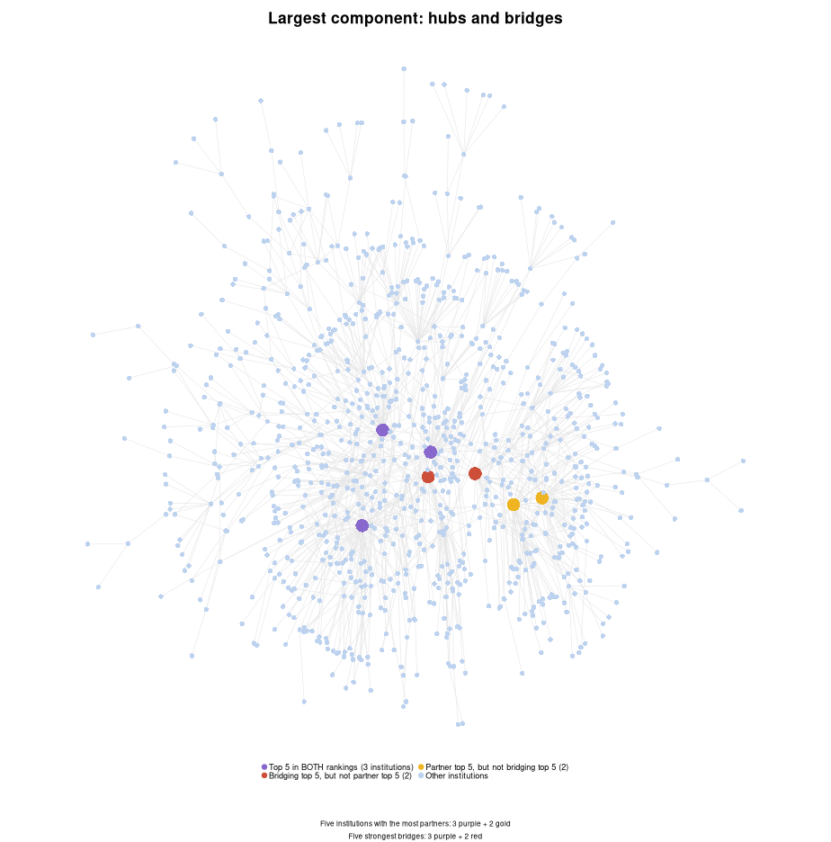
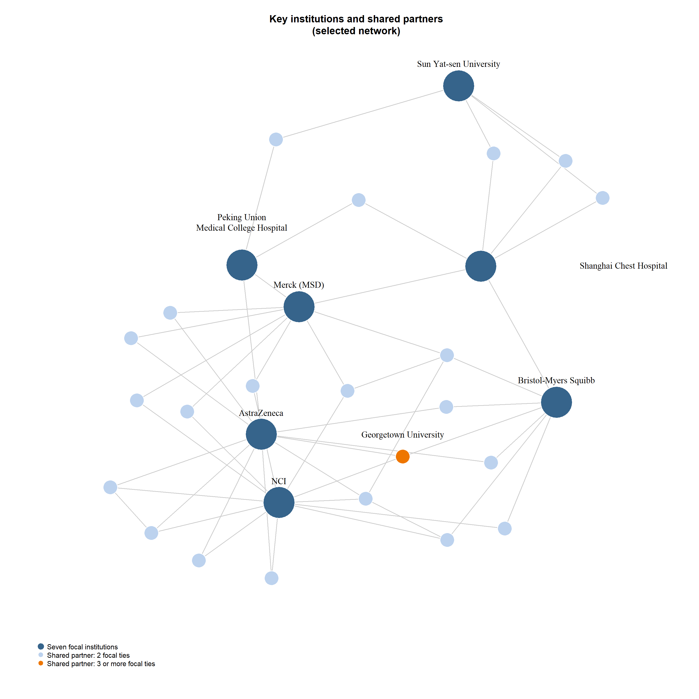

# Clinical Trial Collaboration Network Analysis

**Rui Lu | UNC Chapel Hill | R, igraph**

An analysis of **3,432 global interventional lung cancer trial records initiated in 2020–2024**, examining how partner breadth, structural dependencies, and regional footprints inform decisions about collaboration networks.

The project combines network visualization, centrality analysis, node-removal simulations, and annual site comparisons. It translates the results into recommendations for assessing dependencies and differentiating partner relationships.

## Key findings

| Analytical question | Evidence | Decision implication |
|---|---|---|
| Are institutions with the most partners also the strongest bridges? | The two top-five rankings overlap at three institutions. Sun Yat-sen University has 56 partners; Peking Union Medical College Hospital has 11, but higher betweenness | Assess whom an institution connects alongside the number of its partners |
| How concentrated are structural dependencies? | Removing five top-ranked bridges reduces the largest connected component from 69.4% to 57.5% of original nodes; random removal of five leaves 68.9% on average | Review specific dependencies and alternative connections rather than relying on average connectivity |
| Does local expansion imply stronger international integration? | China-only trials rise from 23.9% to 37.6% of annual trials; trials with both China and US sites fluctuate between 3.2% and 6.1% | Assess local operating scale and international connectivity separately; local expansion does not by itself establish stronger cross-border integration |
| Can repeated collaboration inform partner segmentation? | 124 of 1,610 institutional pairs recur (7.7%), accounting for 19.6% of pair-trial events | Distinguish one-time collaboration from potential strategic relationships and investigate the context behind repeated ties |

The site comparison measures **direct China–US trial-site integration**, not all international cooperation. The management implications are recommendations drawn from clinical research data; this project does not estimate demand, inventory, manufacturing capacity, or operational losses.



## Network views

The harmonized network contains **1,438 organizations, 1,610 distinct sponsor–collaborator pairs, and 154 components**. Its largest component contains 998 organizations.



Purple marks the three institutions in both top-five rankings; red marks the two top-five bridges outside the partner-count top five; gold marks the two top-five partner counts outside the bridging top five. Light blue marks other institutions. Colors indicate network roles, not nationality or detected communities.



The selected view contains the seven highest-betweenness institutions and 22 organizations connected to at least two of them: **29 nodes and 53 edges**. Dark blue marks the seven focal institutions, light blue marks shared partners with two focal ties, and orange marks Georgetown University, with three. Only four pairs among the seven focal institutions have direct recorded ties. This view illustrates shared connections; the analysis uses the full graph or its largest component as specified.

Read [RESULTS.md](RESULTS.md) for the findings, recommendations, and limitations, and [DATA.md](DATA.md) for definitions and denominators.

## Run the analysis

1. Download the repository, keeping `analysis.R` and the raw CSV in the same folder
2. Open `analysis.R` in RStudio and set the working directory to that folder
3. Install the only additional package once, if needed:

   ```r
   install.packages("igraph")
   ```

4. Run the script from the beginning, or run each complete section in order

The script uses sequential base R and igraph code. It saves four CSV tables to `results/` and displays six figures in RStudio's Plots pane. Run each plot together with its title, legend, or annotations. If the whole script is run at once, use the Plots history arrows to view earlier figures.

**The script does not save PNG files automatically.** The six PNGs included here were exported from this final script for GitHub display. Re-export them manually if the analysis or plotting code changes. The script closes existing graphics devices at the beginning of the figures section to clear earlier plotting settings.

## Repository contents

| File | Purpose |
|---|---|
| `analysis.R` | Complete final analysis and plotting code |
| `clinical_trials_lung_cancer_2020_2024_raw.csv` | Frozen ClinicalTrials.gov source extract |
| `RESULTS.md` | Detailed findings and recommendations |
| `DATA.md` | Source provenance, network definitions, and output columns |
| `results/*.csv` | Four tables generated by the script |
| `results/*.png` | Six exported figures |
| `sessionInfo.txt` | Environment used for the verification run |

## Scope and reproducibility

The project records a November 2, 2026 ClinicalTrials.gov download date. The precise historical search expression was not retained, so the included CSV defines the analyzed sample; the project does not claim exhaustive coverage of every eligible trial. The source file contains 3,432 unique NCT identifiers and only interventional studies, with start years from 2020 through 2024. See [DATA.md](DATA.md) for the source checksum and details of two explicit name-grouping assumptions.

Betweenness is normalized within the largest component and calculated with **unweighted paths**. Shared-trial counts represent frequency rather than distance. All removal percentages use the original 1,438 nodes as their denominator; the random benchmark uses 50 draws with seed 42.

The final script was executed end to end with **R 4.5.0 and igraph 2.1.4**. All six figures and four CSV outputs were regenerated from it. Registry records may omit collaborations, node-removal scenarios describe static connectivity, and repeated collaboration alone does not establish a strategic alliance.

Data source: [ClinicalTrials.gov](https://clinicaltrials.gov/). Analysis package: [igraph for R](https://r.igraph.org/).
