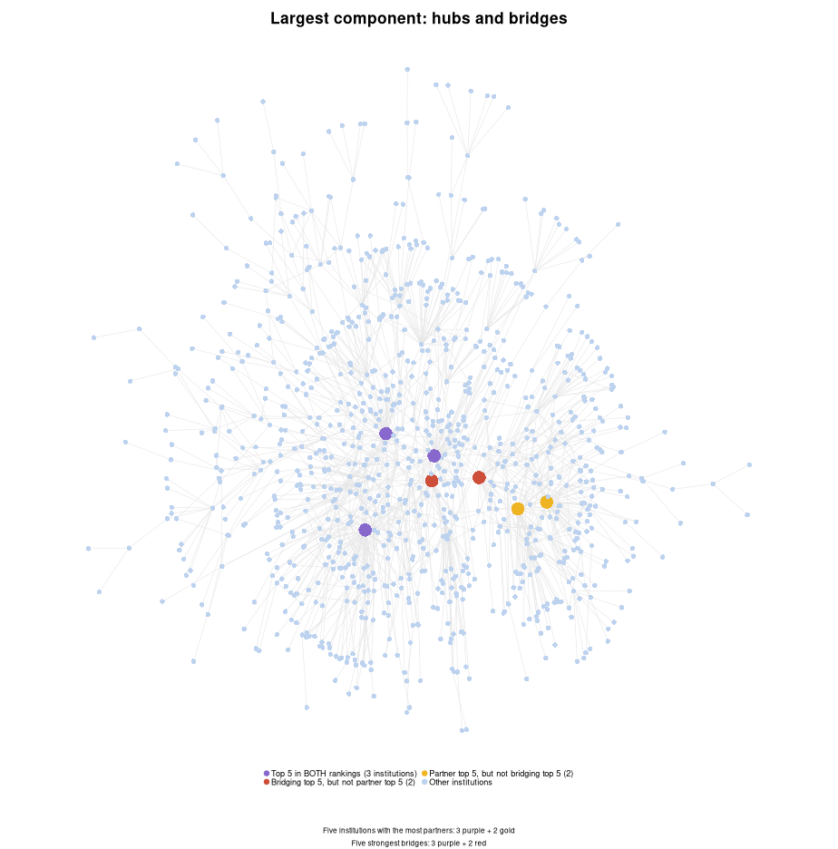
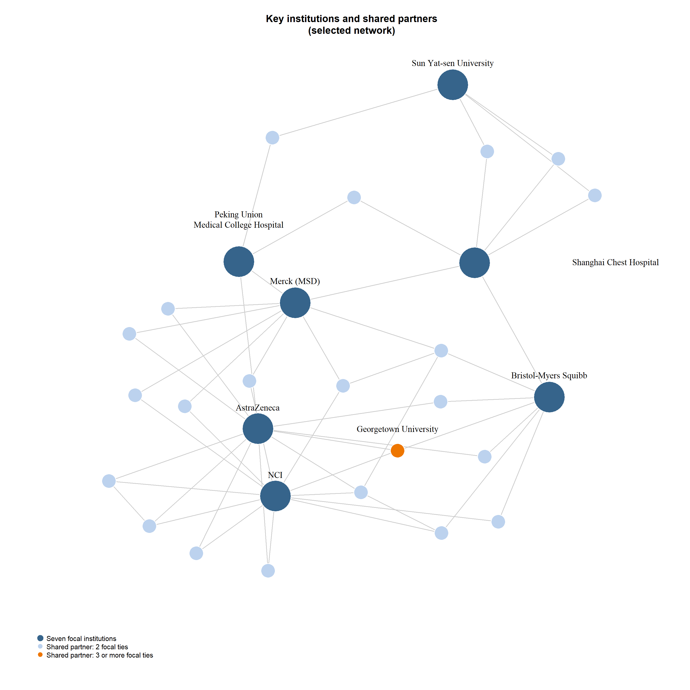
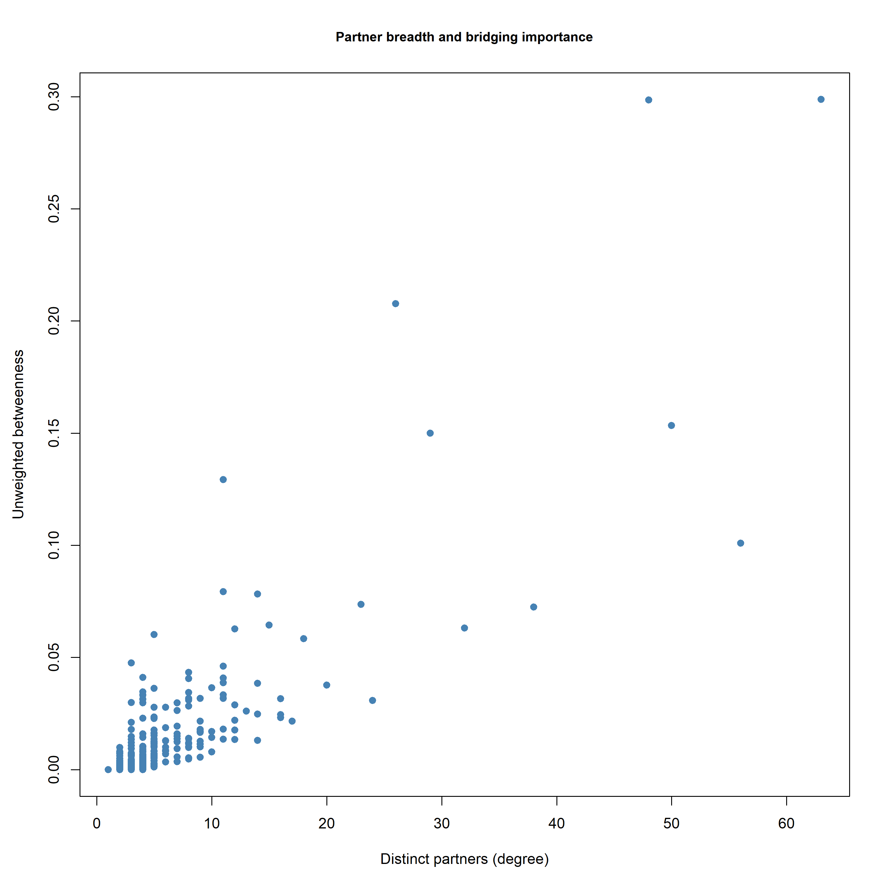
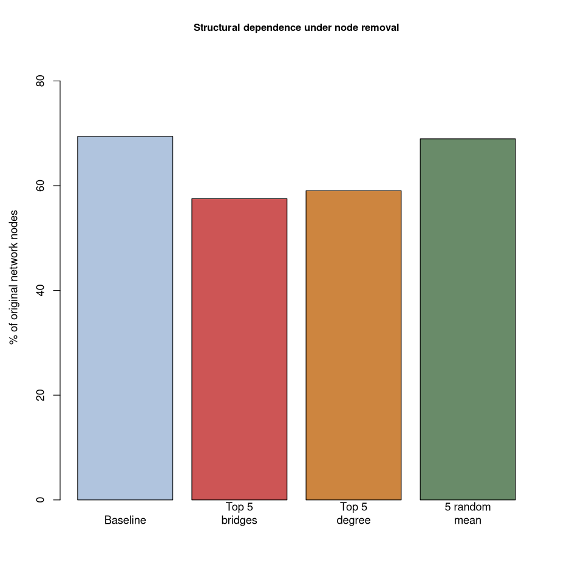
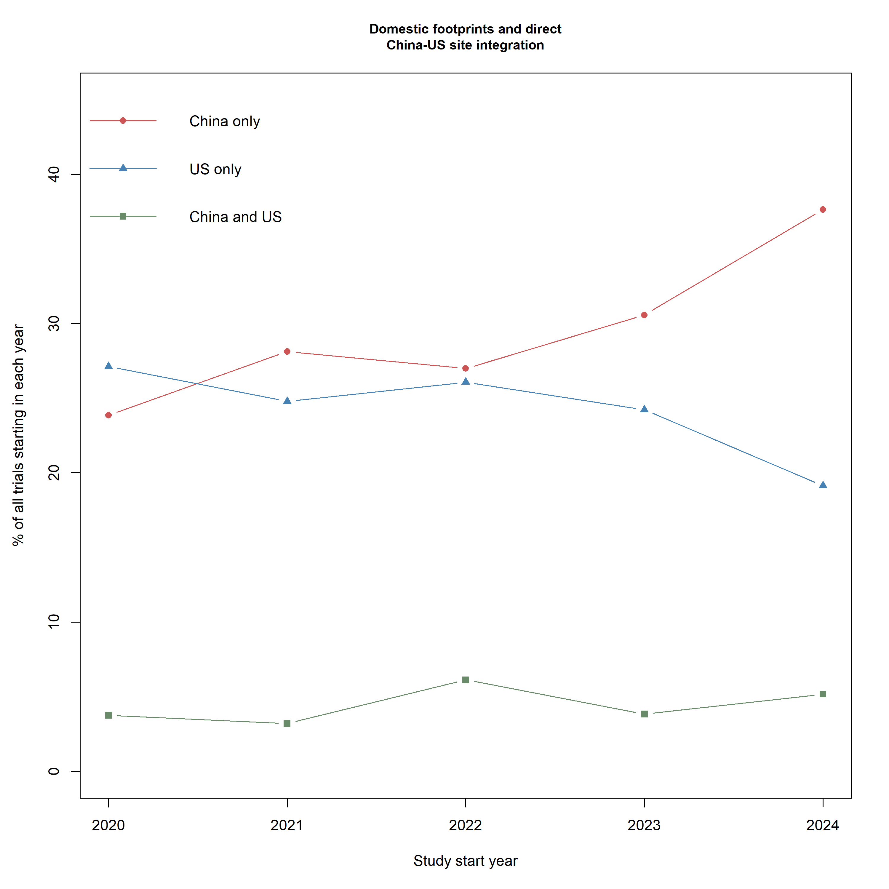
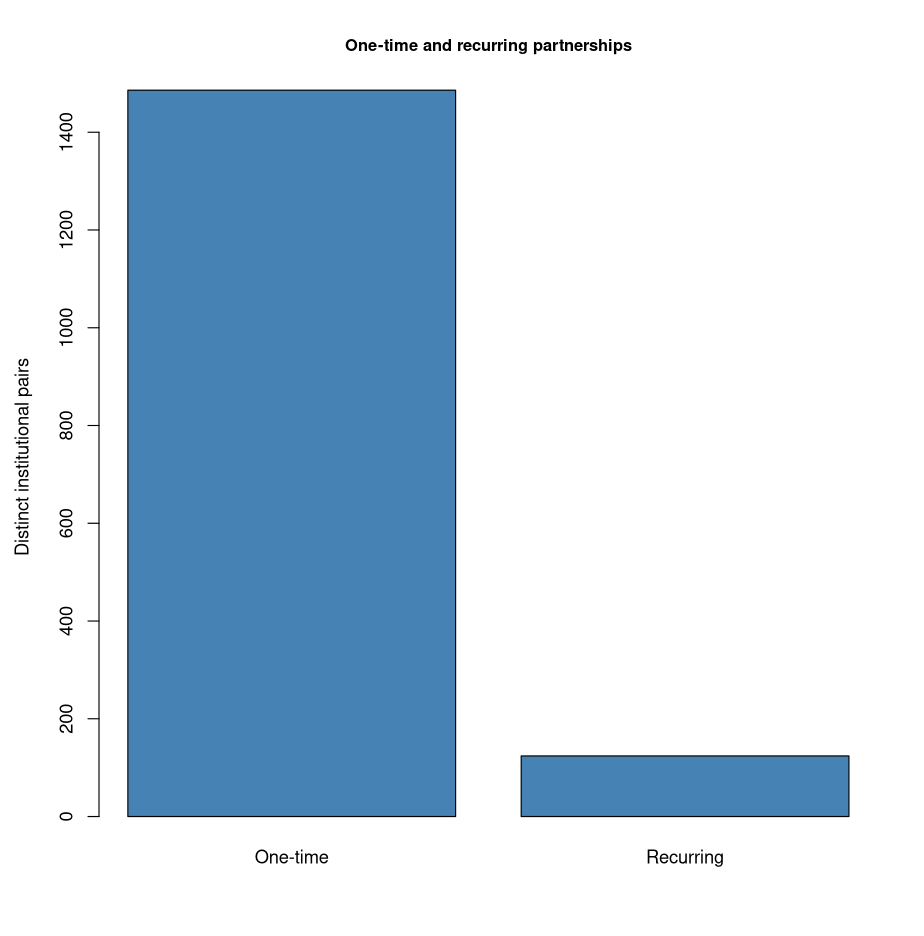

# Clinical Trial Collaboration Network Analysis

**Rui Lu | UNC Chapel Hill | R, igraph**

This analysis examines whether institutions with the most partners also occupy the most important bridging positions, how concentrated dependencies affect network structure, and whether domestic trial expansion corresponds to stronger direct China–US site integration. Results were recomputed from the included ClinicalTrials.gov snapshot, using trials initiated in 2020–2024.

## I. Scope and network structure

| Measure | Recomputed result |
|---|---:|
| Trials | 3,432 |
| Trials listing at least one collaborator | 1,085 (31.6%) |
| Organizations after the documented alias mappings | 1,438 |
| Distinct sponsor–collaborator pairs | 1,610 |
| Connected components | 154 |
| Largest component | 998 organizations (69.4%) |
| Second-largest component | 22 organizations |

An undirected edge links a trial's lead sponsor with a listed collaborator. Collaborators are not linked to one another merely because they appear in the same study. Organizations without a recorded sponsor–collaborator tie are outside this edge-only graph, but their trials remain in the trial-level denominator.

The large core contrasts with much smaller peripheral components. Membership in the core indicates an indirect path through recorded ties, not a direct relationship with every other institution. A blank collaborator field establishes only that no collaborator is listed in this extract; it does not establish whether cooperation occurred or whether reporting was incomplete.

Colors highlight different network roles: purple for the top five on both degree and betweenness, red for top-five betweenness only, gold for top-five degree only, and light blue for other institutions. The background nodes are smaller so that the highlighted institutions remain visible. These are metric-based categories, not community or nationality classifications.

### Selected view of key institutions

The seven highest-betweenness institutions and their shared partners form a **29-organization, 53-edge** subgraph. The 22 shared partners each connect to at least two of the seven; Georgetown University connects to three. Four pairs among the seven have direct recorded ties. This view is selected for readability and does not represent the entire largest component.

## II. Partner breadth and structural brokerage

| Selected institution | Distinct partners | Normalized unweighted betweenness | Betweenness rank |
|---|---:|---:|---:|
| Merck Sharp & Dohme LLC | 63 | 0.2988 | 1 |
| AstraZeneca | 48 | 0.2985 | 2 |
| National Cancer Institute (NCI) | 50 | 0.1533 | 4 |
| Peking Union Medical College Hospital | 11 | 0.1293 | 6 |
| Sun Yat-sen University | 56 | 0.1009 | 7 |

The table presents selected comparisons rather than every institution in rank order. Betweenness is normalized within the largest component and explicitly ignores trial-frequency weights.

Sun Yat-sen University has substantially more partners than Peking Union Medical College Hospital, yet the latter has higher betweenness. Partner breadth and brokerage therefore capture different aspects of importance. The relevant question is whom an institution connects, as well as how many partners it has; a larger portfolio does not automatically provide a more important bridge between groups.

**Recommendation:** assess partner scale and structural position separately, then investigate the availability of alternative paths before assigning priorities. Neither centrality measure alone establishes quality, operational criticality, or substitutability.

## III. Structural dependence under node removal

| Scenario | Largest component, nodes | % of original 1,438 nodes | Remaining components |
|---|---:|---:|---:|
| Baseline | 998 | 69.4% | 154 |
| Remove top 5 unweighted bridges | 827 | 57.5% | 246 |
| Remove top 5 by degree | 849 | 59.0% | 265 |
| Remove 5 random nodes, mean of 50 runs | 991.38 | 68.9% | Varies by run |

The five bridge institutions are Merck Sharp & Dohme LLC, AstraZeneca, Shanghai Chest Hospital, National Cancer Institute (NCI), and Bristol-Myers Squibb. Removing them reduces the largest-component share by **11.9 percentage points**, compared with about **0.5 percentage points** on average under random removal.

Random-removal outcomes have a standard deviation of **0.384 percentage points** across 50 simulated draws. This describes the variation in this benchmark, not the uncertainty of actual operational disruption.

The comparison supports the conclusion that the observed network is more sensitive to the targeted loss of selected bridges than to random loss. Degree-based removal produces more components, while bridge-based removal leaves a smaller core; both outcomes are useful for assessing fragmentation.

**Recommendation:** investigate specific dependencies rather than relying only on average network connectivity. The simulation does not model replacement partners, recovery, trial delays, or financial loss.

## IV. Domestic expansion and direct China–US site integration

| Start year | All trials | China-only trials | US-only trials | Trials with sites in both countries |
|---|---:|---:|---:|---:|
| 2020 | 612 | 146 (23.9%) | 166 (27.1%) | 23 (3.8%) |
| 2021 | 718 | 202 (28.1%) | 178 (24.8%) | 23 (3.2%) |
| 2022 | 652 | 176 (27.0%) | 170 (26.1%) | 40 (6.1%) |
| 2023 | 677 | 207 (30.6%) | 164 (24.2%) | 26 (3.8%) |
| 2024 | 773 | 291 (37.6%) | 148 (19.1%) | 40 (5.2%) |

All percentages use all trials starting in the corresponding year, including missing locations. “China only” and “US only” require all recorded sites to be in that country. The both-country category permits additional sites elsewhere. **152 trials** have confirmed sites in both China and the US across the five cohorts.

China-only trials increase by **13.8 percentage points using unrounded source percentages**; the difference between displayed one-decimal endpoints is 13.7 points. The US-only proportion declines by 8.0 points. Direct China–US site integration remains limited and fluctuates between 3.2% and 6.1%, rather than rising consistently; its endpoint nevertheless increases from 3.8% to 5.2%.

**Recommendation:** assess local operating scale and global network integration separately rather than equating local expansion with stronger international connectivity. The evidence measures direct China–US site integration and should not be generalized to all of China's international research connections or to manufacturing capacity.

## V. Repeated collaboration and partner segmentation

| Unit and denominator | Recomputed result |
|---|---:|
| One-time pairs / all distinct pairs | 1,486 / 1,610 (92.3%) |
| Recurring pairs / all distinct pairs | 124 / 1,610 (7.7%) |
| Pair-trial events involving recurring pairs / all pair-trial events | 363 / 1,849 (19.6%) |

A trial can generate multiple sponsor–collaborator pairs. The 19.6% activity measure therefore does not describe the percentage of all 3,432 trials, nor the percentage of distinct pairs.

**Recommendation:** distinguish one-time collaborations from potential strategic relationships and apply different management approaches. Recurring ties can motivate closer relationship review and joint planning, while one-time collaborations may call for more specific coordination. Frequency alone does not prove strategic importance, continuous collaboration, shared objectives, or exclusivity. A single recorded collaboration can itself be strategically critical.

## VI. Implications for operational analysis

The findings support three complementary decision habits: separate partner volume from structural role, test concentrated dependencies against a random benchmark, and distinguish regional expansion from cross-border integration. These are useful ways to frame partner assessments and contingency reviews. The underlying observations concern registered clinical research collaborations and trial sites; they do not directly measure supply, capacity, product flows, demand forecasts, or inventory.

Recommendations remain proposed actions rather than implemented improvements. Recurring relationships warrant contextual review before being treated as strategic; observed network position alone cannot establish operational importance.

## VII. Methods and limitations

The script follows a sequential base R and igraph workflow. The two inherited name mappings are visible in the code; they are analytical grouping assumptions rather than independently established legal-entity equivalences. Without those mappings, the graph contains 1,440 organizations and a 1,000-node core. The main results consistently use 1,438 organizations and a 998-node core.

Betweenness is normalized within the largest component and calculated with `weights = NA`, because shared-trial counts represent frequency rather than distance. Removal shares use the original 1,438 nodes as their denominator. Random removal uses seed 42 and 50 draws.

The location comparison uses the final country field in the supplied pipe-separated site entries. China-only and US-only require every extracted country field to match that country. Both-country trials can include third-country sites. The procedure does not classify all other countries or infer country from organization names. Its 15 headline annual counts match the independently checked source counts.

Most sampled trials list no collaborator, and registry records do not capture every form of cooperation. Universities and affiliated hospitals are kept separate. A centrality rank does not establish quality or irreplaceability; static removal does not simulate replacement partners, trial delays, or financial losses. Repetition within the study window does not establish persistence beyond it.

The final script was executed end to end on the frozen source data with R 4.5.0 and igraph 2.1.4. Four CSV tables and six figures were regenerated from this script. `results/centrality.csv` contains the 998 organizations in the largest component; it is not a table of every organization in the full graph. See [DATA.md](DATA.md) for definitions and [sessionInfo.txt](sessionInfo.txt) for the verification environment.
